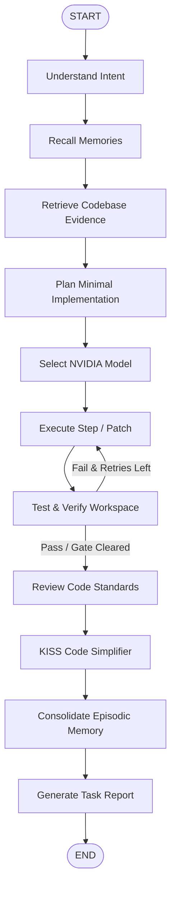

# OMNICODE AI 5.0 — System Architecture Specification

## 1. Executive Summary & Vision

**OMNICODE AI 5.0** is a single unified, NVIDIA-powered, self-improving autonomous software engineer.
It unites the best software engineering capabilities of leading developer tools into **one canonical agent controller** governed by LangGraph:
- **Cursor**: Multi-file editing, AST symbol navigation, inline completions.
- **Claude Code**: Deep terminal workflows, stack trace diagnosis, codebase reasoning.
- **OpenAI Codex**: Isolated sandboxed code execution, test-driven validation.
- **GitHub Copilot**: Version control workflows, git diff inspection, pull requests.
- **Cline & Roo Code**: Flexible MCP tool registry, risk classification, permission gates.
- **Devin**: Long-running autonomous lifecycle, episodic memory, evidence-backed self-improvement.

OMNICODE rejects multiple fragmented assistants or external subscription dependencies. It relies strictly on **NVIDIA inference** endpoints (`https://integrate.api.nvidia.com/v1` or local NVIDIA NIM containers), LangGraph, Agentic RAG, episodic memory, and real code execution.

---

## 2. One Unified Agent Architecture

OMNICODE AI maintains strict architectural unity:
- **One Identity**: OMNICODE AI 5.0.
- **One Controller**: Single LangGraph `StateGraph` in `core/agent/graph.py`.
- **One Canonical State**: `OmnicodeState` in `core/agent/state.py`.
- **One Memory Engine**: `UnifiedMemoryManager` (Working, Semantic, Episodic, Procedural).
- **One Repository Knowledge System**: `AgenticRetriever` (AST parsing, BM25, NVIDIA Embeddings, Symbol Table, Reranking).
- **One Secure Tool Runtime**: `CommandSandbox` and `SecurityPolicy`.
- **One Unified Interface**: CLI (`cli/main.py`) and Web IDE Studio (`apps/web`).

---

## 3. Operating Pipeline Stages

1. **UNDERSTAND**: Parses developer instructions, establishes task intent, initializes checkpointer thread state.
2. **RECALL**: Recalls verified past debugging episodes, repo architecture conventions, and procedural recipes.
3. **RETRIEVE**: Performs 7-stage Agentic RAG over workspace files.
4. **PLAN**: Formulates explicit acceptance criteria and a minimal 3-5 step plan conforming to KISS and YAGNI.
5. **SELECT_MODEL**: Evaluates complexity and chooses optimal NVIDIA model via capability-aware routing profiles.
6. **EXECUTE**: Dispatches MCP tools, writes files, or executes shell commands within the isolated sandbox.
7. **TEST**: Executes pytest suite, parses structured stack traces, and detects regressions.
8. **REVIEW**: Audits changes against KISS, DRY, SOLID, and OWASP security rules.
9. **SIMPLIFY**: Eliminates unused imports, redundant wrapper classes, and dead code.
10. **LEARN**: Consolidates verified root cause, passing patch, and reusable lesson into SQLite episodic memory.
11. **REPORT**: Generates structured, evidence-based release report.

---

## 4. NVIDIA AI Inference & Model Routing

OMNICODE connects directly to NVIDIA hosted endpoints or self-hosted NIM containers:
- **Default Hosted Endpoint**: `https://integrate.api.nvidia.com/v1`
- **Authentication**: `NVIDIA_API_KEY`

### Routing Profiles:
| Profile | Default Model | Primary Use Case | Context Window |
| :--- | :--- | :--- | :--- |
| `FAST` | `meta/llama-3.1-8b-instruct` | Inline completions, file inspection, syntax checking | 131,072 |
| `BALANCED` | `meta/llama-3.3-70b-instruct` | General coding, planning, bug fixing, tool calling | 131,072 |
| `DEEP` | `deepseek-ai/deepseek-r1` | Complex algorithmic reasoning, multi-file architecture | 131,072 |
| `BUDGET` | `meta/llama-3.1-8b-instruct` | Token-constrained execution, batch reviews | 131,072 |
| `PRIVATE_NIM` | Self-hosted NIM container | Air-gapped on-premise execution | Configurable |

---

## 5. Agentic RAG & Repository Intelligence

OMNICODE implements a bounded, 7-stage retrieval loop that prevents context bloat:
1. **Query Interpretation**: Extracts identifiers, symbols, and keywords using regex tokenization.
2. **Candidate Filtering**: Maps tests to candidate source files and scans modified paths.
3. **Lexical Search**: Okapi BM25 index over code chunks.
4. **Semantic Retrieval**: NVIDIA NV-EmbedQA vector similarity matching.
5. **Symbol Graph Traversal**: AST definition lookups and reference call tracing.
6. **Cross-Encoder Reranking**: NVIDIA NV-RerankQA candidate scoring.
7. **Context Compression**: Enforces strict token budgets and prevents whole-repo dump.

---

## 6. Persistent 4-Tier Memory System

- **Working Memory**: In-memory active scratchpad, current plan step, intermediate observations.
- **Semantic Memory**: Long-term verified architecture notes, API schemas, and dependency rules.
- **Episodic Memory**: Detailed historical records containing objective, symptoms, root cause, passing patch, failed approaches, and lessons learned.
- **Procedural Memory**: Reusable engineering recipes (e.g., TDD bug fix, KISS simplification).

---

## 7. Security and Quality Gate Scorecard

Every change is evaluated against non-negotiable quality gates:
- **Correctness (30%)**: Passing unit and integration tests.
- **Security (25%)**: Zero credential leaks, zero dangerous code injection (`eval`, `exec`).
- **Simplicity & KISS (15%)**: Zero redundant wrappers or dead code.
- **Maintainability (10%)**: Low cyclomatic complexity, clear contracts.
- **Test Quality (10%)**: Assertive behavioral assertions.
- **Operational Safety (10%)**: Strict workspace root boundary containment.
